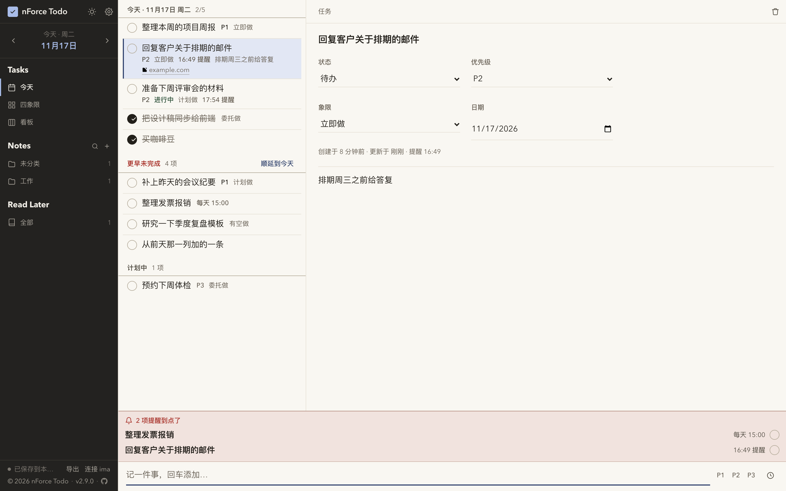
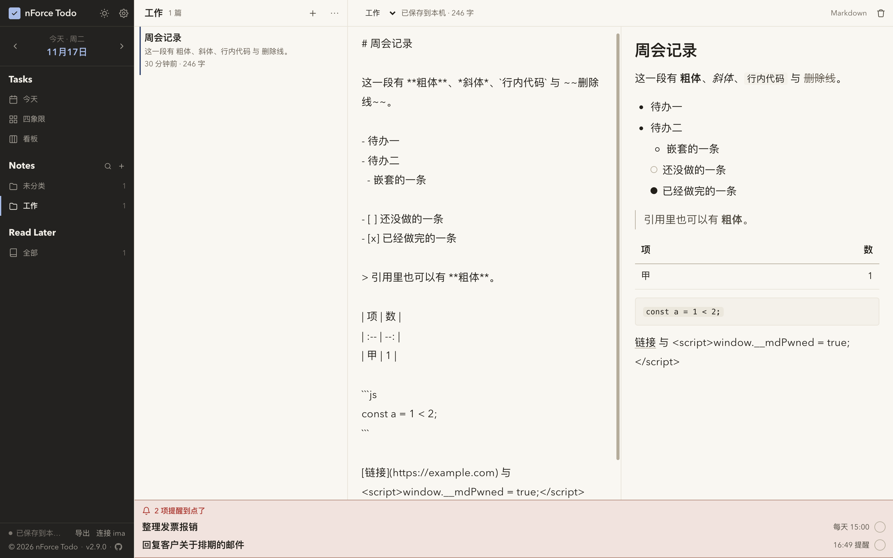

这一版：界面可以切英文了，在设置里选，英文是出厂值。

*点工具栏图标就是它：一条顶栏、输入行、今天的清单，底部一行状态。*

- **文案以中文原文当 key**（`lib/i18n.js`）。这不是偷懒：600 个调用点一个都不用改，字面量还在原地，`t()` 查不到就原样返回 —— 于是「漏翻」表现为中文，而不是空标签或 `i18n.key.0413`。
- 三个入口：`t('进行中')`（JS 整串，`el()` / `toast()` 自动过一遍字典）、`tn('${n} 篇', { n })`（带插值的句子，英文语序自己写）、`applyDom()`（静态 HTML 的文本节点与 `title` / `aria-label` / `placeholder`，按内容查表，**HTML 里一个 `data-i18n` 都不用加**）。
- 静态 HTML 里被 `<strong>`/`<code>`/`<a>` 切成碎片的长段落是唯一例外：碎片各自成句，逐片翻会把词序翻乱，所以那几段挂 `data-i18n="块 id"`，整段换一份英文 HTML；中文原文在第一次应用时从 DOM 里存下来，切回去原样放回。
- 设置 → 外观 → **语言**：English / 简体中文，切过去立刻生效（不用重启）。出厂 `en`。

## 另外两个面

*三列：导航 / 列表 / 详情。提醒条和输入行在最下面那一条横带上。*

*左边写 Markdown，右边同时是它读起来的样子。*

下载：<https://github.com/iamnicwu/nForce-Todo/releases/tag/v2.10.0>（源码包与可加载的 zip）。
