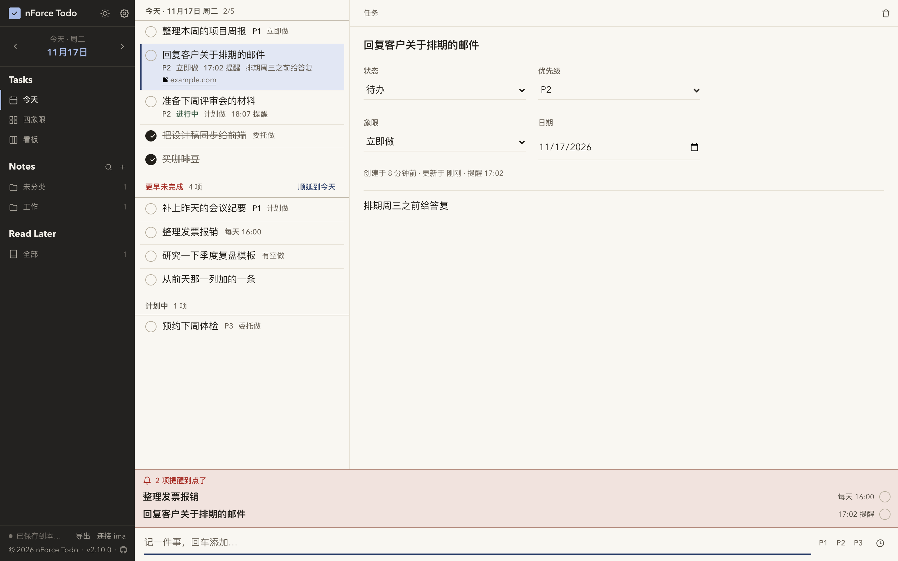
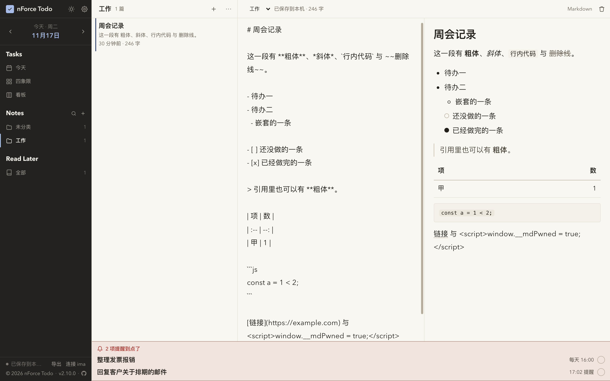

这一版：弹窗顶栏的三个入口合成一个「工作台」。

*点工具栏图标就是它：一条顶栏、输入行、今天的清单，底部一行状态。*

- 之前：`笔记` / `稍后读 N` / `⤢` 三颗按钮 —— **都落到同一个页面**，只是停在不同的一节（`#notes` / `#reading` / 无 hash）。三个入口做同一件事。
- 现在：一颗 `工作台`，不带 `section`。分类与稍后读就在那边的导航里，到了那儿一步就到；而不带 hash 反而更准 —— 工作台记得你上次停在哪一节，比这个 384px 的窗口猜得好。
- 顶栏从 `▣ 存这个页面 荧光笔 ⋯ 笔记 稍后读 N ⤢ ⚙` 变成 `▣ 存这个页面 荧光笔 ⋯ 工作台 ⚙`：四颗工具 + 两个图标 → 两颗工具 + 一个去处 + 设置。
- 代价说清楚：**「稍后读 N」上的未读数没有了**。它在工作台的导航里，只是不再在弹窗上提醒你。这是合并的代价，不是疏漏。

## 另外两个面

*三列：导航 / 列表 / 详情。提醒条和输入行在最下面那一条横带上。*

*左边写 Markdown，右边同时是它读起来的样子。*

下载：<https://github.com/iamnicwu/nForce-Todo/releases/tag/v2.11.0>（源码包与可加载的 zip）。
