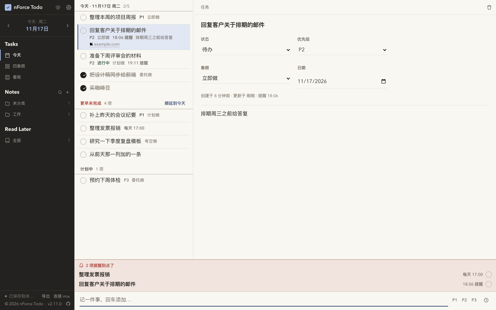
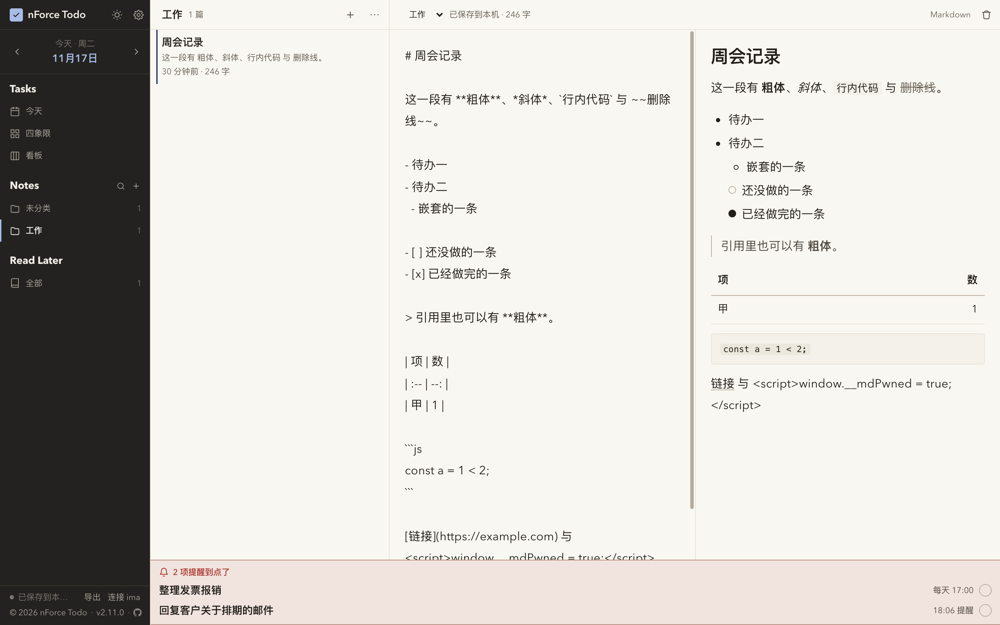

这一版：`#标题` 不打空格也认了。

*点工具栏图标就是它：一条顶栏、输入行、今天的清单，底部一行状态。*

- 用户报的：写 `#定义 header` 解析不出来。另一半原因在还原现场 —— 中文写作里 `#` 后面经常不打空格（`#标题`），而 CommonMark 要求那个空格，于是整行落进段落，读者看到一个字面的 `#`。
- 单独一个 `#` 仍然不是标题（别造出空的一级标题）。
- 单测 399 → **401**，真机 341 → **342**。

## 另外两个面

*三列：导航 / 列表 / 详情。提醒条和输入行在最下面那一条横带上。*

*左边写 Markdown，右边同时是它读起来的样子。*

下载：<https://github.com/iamnicwu/nForce-Todo/releases/tag/v2.11.1>（源码包与可加载的 zip）。
