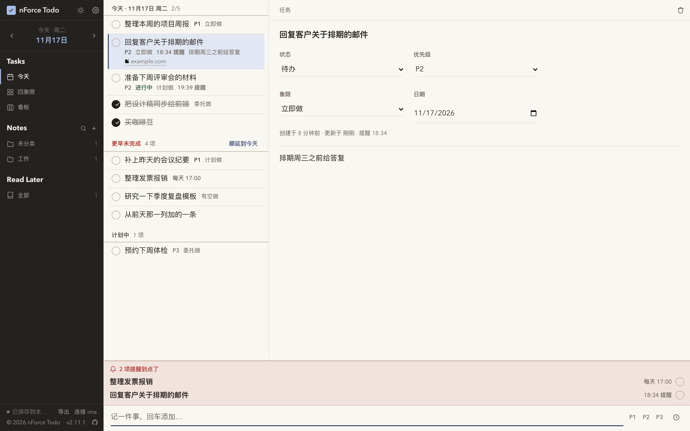
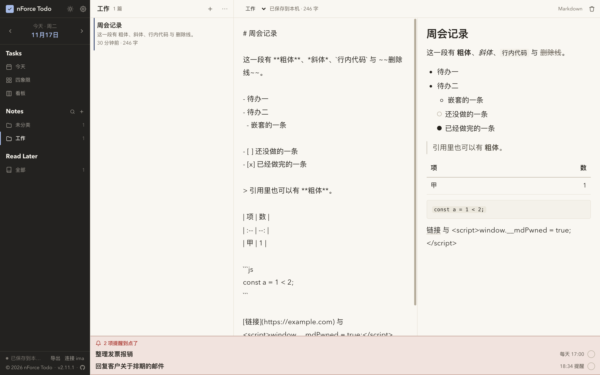

这一版：设置页从「七张卡片铺两千多像素」变成「七行模块，点开才展开」。

*点工具栏图标就是它：一条顶栏、输入行、今天的清单，底部一行状态。*

- 用户原话：「内容太多导致用户觉得很乱」。之前七个分区全部展开，加起来 2 600px，一屏看不完 —— 找一个开关等于滚动找。现在整页约 540px，一屏读完。
- **折叠的代价是「看不到」，补偿是每个标题右边写着当前值**：`外观与语言 · 浅色 · 标准 · 简体中文`、`提醒 · 系统通知：关`、`本机数据 · 9 项任务`、`同步到 ima · 关闭 · 未连接`、`备份记录 · 最近 2 条`。不做这行，折叠就只是把内容藏起来。
- **顺序按常用程度**：外观与语言 → 提醒 → 本机数据 → 稍后读 → 同步到 ima → 备份记录 → 快照预览。「连接 ima 知识库」并进了「同步到 ima」（凭证是那个开关的前提，不是另一件事）。
- **单开**：点开第二个，第一个自己关上。挂在 `summary` 的 click 上，不挂 `toggle` —— 脚本设 `.open` 也会触发 toggle，于是「一次全展开去量内容」会被自己关掉六个。也没用 `
`：原生手风琴会连脚本里的 `.open` 一起管住。
- **字号跟工作台对齐**（标题 15 / 标签 12，正文 14），不再是自己一套 13.5；**页面从 760 加宽到 880**。
- 删掉左侧分区索引：七行高的页面不需要索引，它本身就是一个索引。

## 另外两个面

*三列：导航 / 列表 / 详情。提醒条和输入行在最下面那一条横带上。*

*左边写 Markdown，右边同时是它读起来的样子。*

下载：<https://github.com/iamnicwu/nForce-Todo/releases/tag/v2.12.0>（源码包与可加载的 zip）。
