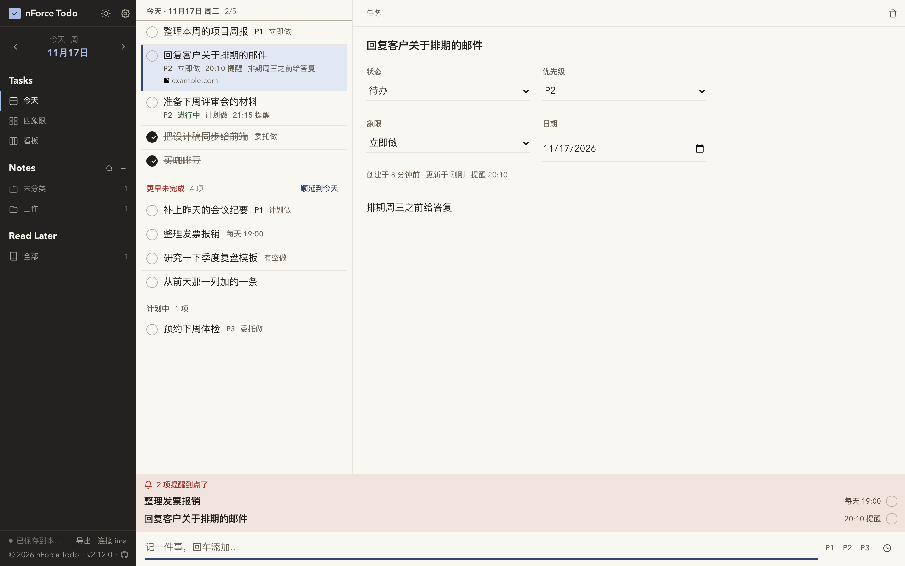
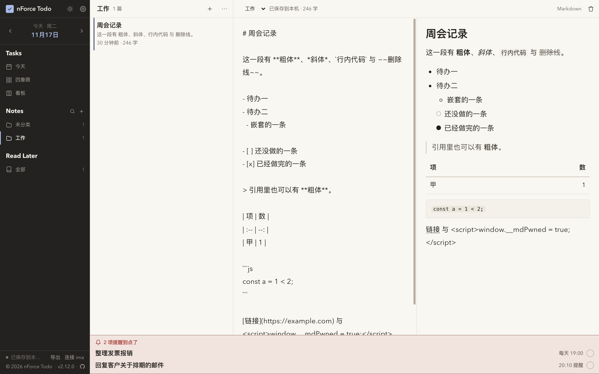

这一版：设置页真的居中了。

*点工具栏图标就是它：一条顶栏、输入行、今天的清单，底部一行状态。*

- 2.12.0 删掉左侧索引之后，那条只在有索引时成立的响应式规则还留着：`≥1000px` 时页面是 `152px + 720px` 的栅格。索引没了，第一列空着，内容被推到右边、右边只剩 80px —— 一屏里左留白 277、右留白 82。

## 另外两个面

*三列：导航 / 列表 / 详情。提醒条和输入行在最下面那一条横带上。*

*左边写 Markdown，右边同时是它读起来的样子。*

下载：<https://github.com/iamnicwu/nForce-Todo/releases/tag/v2.12.1>（源码包与可加载的 zip）。
