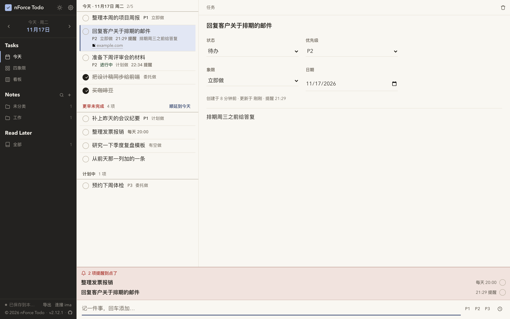
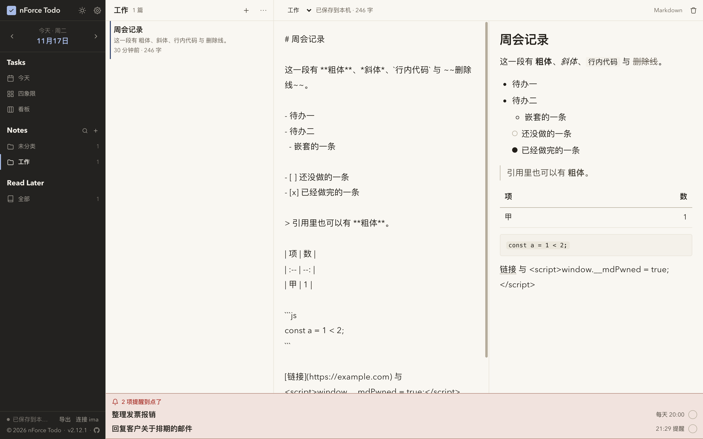

这一版：四象限有了「深浅」，看板上的任务变成了真的卡片。

*点工具栏图标就是它：一条顶栏、输入行、今天的清单，底部一行状态。*

- 用户原话：「matrix 和 board 太简陋，没有任何设计感」。
- **四象限**：① 顶上一条列轴（紧急 / 不紧急），每格自己写坐标（「立即做 · 重要 · 紧急」）—— 不写出来，用户得先知道艾森豪威尔那套；② 四格底色按「多急」排成一道阶梯：立即做（赭 11%）> 计划做（墨 5.5%）> 委托做（墨 3.5%）> 有空做（= 纸本身）。**只有最急那格带色相**，用的是它自己圆点那支赭；也没有圆角、阴影、描边 —— 那是盒子的做法。
- **看板**：① 卡片有了纸面 + 1px 描边 + 4px 圆角 + 极浅投影（DESIGN 里允许有面的少数东西之一），卡片之间 6px 呼吸，悬停抬起一格；② 每个列头压一条 2px 脊线，颜色就是这一列的状态 —— 进行中是松绿；③ **三条泳道拉满整片高度**：之前只有卡片那一小段能接住拖放，下面大片纸是死的。

## 另外两个面

*三列：导航 / 列表 / 详情。提醒条和输入行在最下面那一条横带上。*

*左边写 Markdown，右边同时是它读起来的样子。*

下载：<https://github.com/iamnicwu/nForce-Todo/releases/tag/v2.13.0>（源码包与可加载的 zip）。
