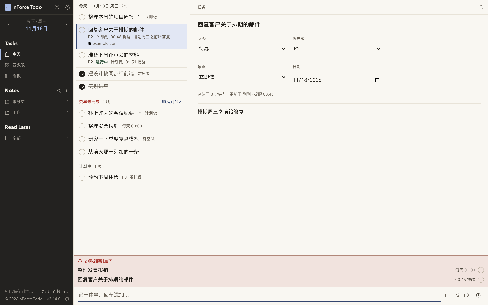
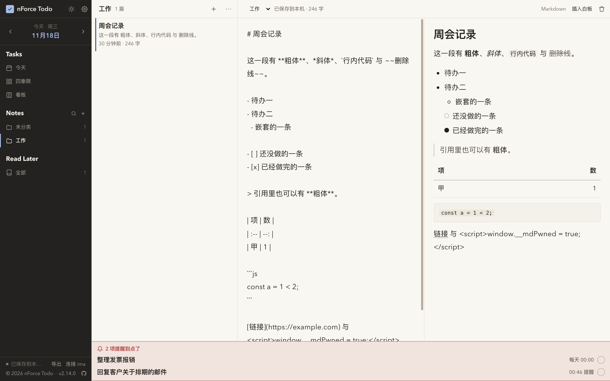

这一版：笔记里能画 Excalidraw 白板了，画完自动保存。


*点工具栏图标就是它：一条顶栏、输入行、今天的清单，底部一行状态。*

- **画板住在笔记正文里**：一个 ```` ```excalidraw ```` 围栏块，块内一行 JSON（标准的 `.excalidraw` 格式，另加一个 `blockId`）。所以导出 JSON、ima 快照、本地备份**一条路径都不用改** —— 它本来就是正文的一部分。
- **Excalidraw 是本地文件**：MV3 默认 CSP（`script-src 'self'`）禁掉一切 CDN，所以 React + `@excalidraw/excalidraw` 预构建进 `vendor/excalidraw/`，用 `chrome.runtime.getURL` + `@vite-ignore` 懒加载（3.13 MiB / gzip 1.16 MiB）。字体、语言包同级摆放，`EXCALIDRAW_ASSET_PATH` 指向它。
- **体积的代价说清楚**：`vendor/` 合计 **17.37 MiB**，其中 12.5 MiB 是中文手写体 Xiaolai（209 个分片）。因此发布包从 ~1 MB 变成 **~18 MB**（源码包 ~19 MB）。这是「保留全量字体」这个选择的直接后果；将来要瘦身，杠杆是把 Xiaolai 改成分片按需加载，不是砍功能。
- **画布就是这张纸**：挂载时从 `--bg` 读页面底色塞进 `viewBackgroundColor`（暖纸里不许嵌一块纯白），但**只注入不落盘**——写进笔记之后它就变成「用户的选择」，暗色主题下再打开会看到深色纸里浮着一块暖白板。用户自己改过底色则一切照旧。
- **自动保存**：`onChange` 只更新内存（指纹 = 元素 `id:version:versionNonce`，滚动和选中不写盘），600ms 防抖后原位写回正文。`flush` / 切笔记 / 切 section / `pagehide` 之前**先 compose**——`pagehide` 同步读正文，不 compose 就丢最后一笔。
- **三条硬守卫**：正文到 200 000 字上限时**不写**（并回滚画布），绝不让 `normalizeNoteBody` 的 `slice` 把 JSON 切一半；配额错误翻成人话（「本机存储空间不够了：删掉几篇旧笔记再试」）；块内 JSON 读不出来时**只读**，绝不覆盖用户原稿。
- **一个数要记住**：4 个图元（含一条 40 点手绘线）约 3 572 字，所以 200 000 字上限 ≈ **200 个图元 ≈ 2–5 张中等复杂的白板**。这不是「200k 很大」。
- 这一版顺带修掉两个**不修就会静默坏掉**的 bug：① 画板把整个围栏块当成「块内 JSON」传给写回函数 → 每一笔都被判「读不出来」然后丢弃；② 从白板返回后分类下拉是空的（面板重建后 `folderKey` 缓存说「填过了」），这篇笔记再也改不了分类。

## 另外两个面



*三列：导航 / 列表 / 详情。提醒条和输入行在最下面那一条横带上。*



*左边写 Markdown，右边同时是它读起来的样子。*

下载：<https://github.com/iamnicwu/nForce-Todo/releases/tag/v2.14.0>（源码包与可加载的 zip）。
