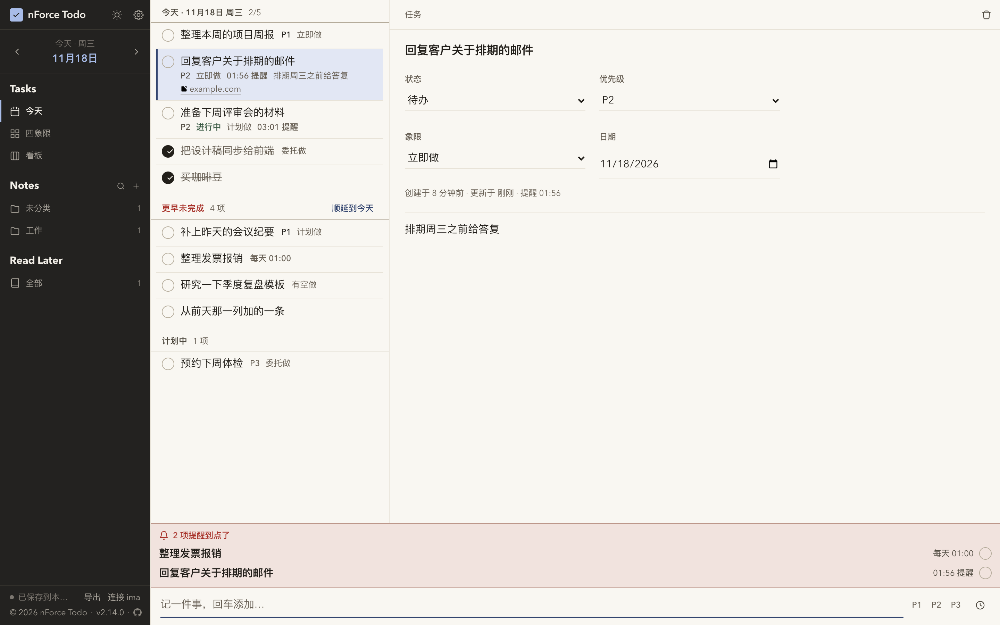
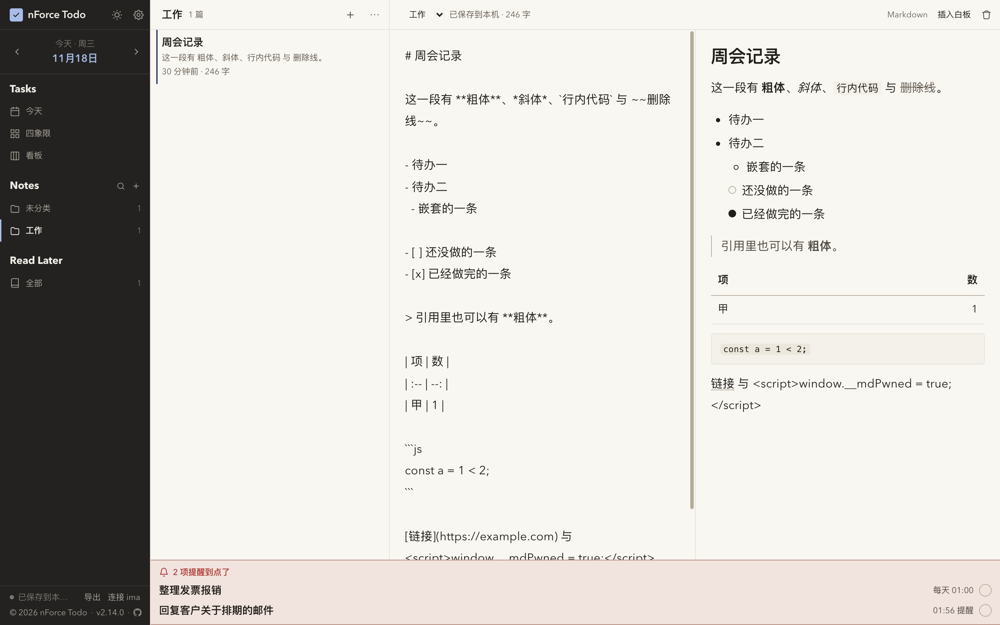

这一版：砍掉 12 MB 的中文手写体；贴进来的 `.excalidraw` 不再是点不开的死卡。


*点工具栏图标就是它：一条顶栏、输入行、今天的清单，底部一行状态。*

- **体积**：`vendor/` 从 **17.37 MiB → 5.5 MiB**（发布包约 18 MB → 约 6 MB）。砍掉的是 `fonts/Xiaolai/`（209 个分片、12 MB 的中文手写体）。代价：白板里用「手绘字体」写中文会回落系统字体，画面不坏，只是不是手写体。
  - `tools/build-vendor.mjs` 的 `SKIP_FONTS` 是唯一排除名单；`tools/check-vendor.mjs` **反过来守**「它不许再出现」——体积是用户能看见的成本，不能靠记得。
- **修：从 excalidraw.com 导出的 `.excalidraw` 打不开。** 那种文件没有我们私有的 `blockId`，以前被判成「数据读不出来」→ 一张禁用的卡，点了没反应。现在：形状像 `.excalidraw`（`type` 或 `elements`）就收下，按**文档顺序**补一个临时 id（`bx-foreign-0`），第一次保存时把这个 id 写进 JSON，从此不再靠序号。
- **修：引用里的围栏是死链。** 渲染器把 `> ```excalidraw ` 当白板画了卡，而正文解析不认 `> ` 前缀 → 点开报「这块白板在正文里找不到了」。现在引用里的围栏按普通代码块渲染，两边判定一致。
- 单测 413 → **415**，真机 372 → **373**（新增一条走真路径：贴进正文 → 预览长卡 → 点开画板 → 把正文改回去）。

## 另外两个面



*三列：导航 / 列表 / 详情。提醒条和输入行在最下面那一条横带上。*



*左边写 Markdown，右边同时是它读起来的样子。*

下载：<https://github.com/iamnicwu/nForce-Todo/releases/tag/v2.14.1>（源码包与可加载的 zip）。
