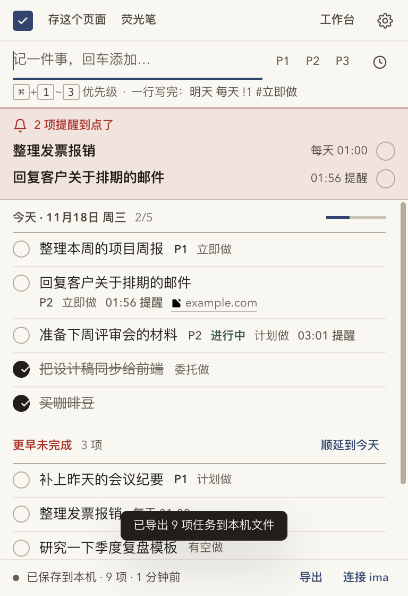
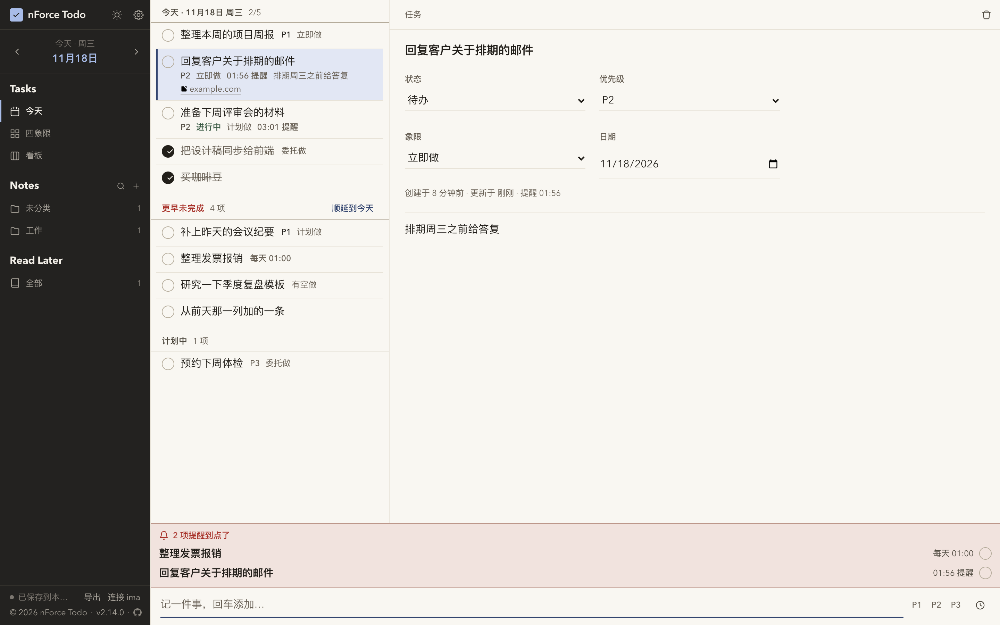
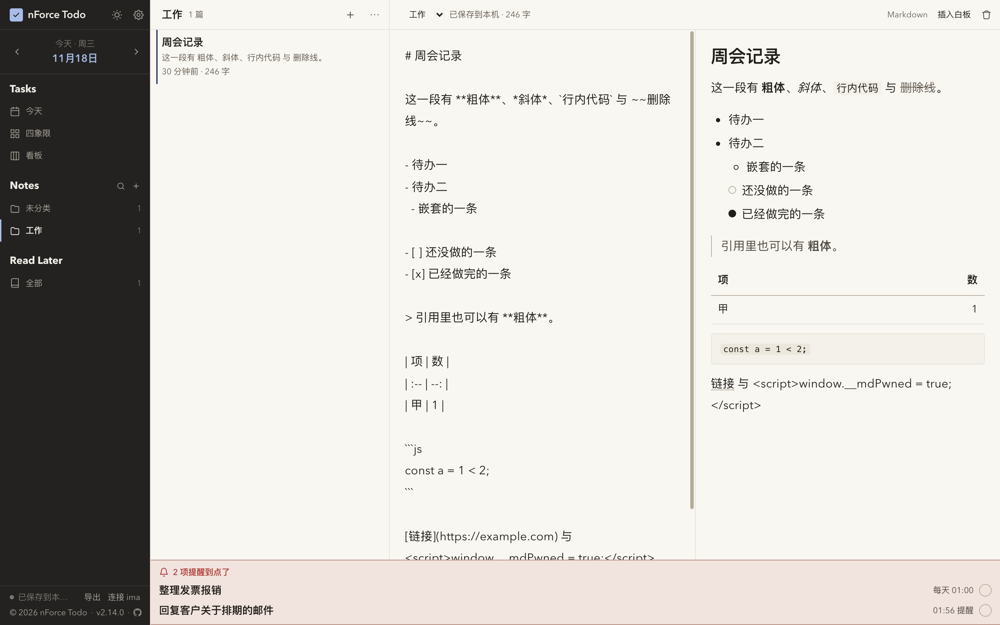

这一版：发版文章里的截图，从此按「这一版改了什么」来选。

*点工具栏图标就是它：一条顶栏、输入行、今天的清单，底部一行状态。*

- 之前 `tools/blog-post.mjs` 固定用三张主图（弹窗 / 今天 / 笔记）。于是**白板那一版的文章配着弹窗和清单的图**——读者读完标题再看图，会以为这一版在改界面。
- 现在：README 那一节里写一行 HTML 注释 `shots: a.png, b.png`，这一版就用这几张；**第一张同时是封面**，所以顺序有意义。不写仍然是三张主图。
- 没登记过说明的图（比如新加的 `app-board.png`）用文件名当替代文字，不硬编一句话冒充说明。
- 文件名打错**不会静默发出去**：发布时直接失败，并把 `screenshots/` 里现有的文件名列出来。
- 指令本身不会出现在文章里（它是写给工具看的）。`AGENTS.md` 的发布流程里写了用法。

## 另外几张

*三列：导航 / 列表 / 详情。提醒条和输入行在最下面那一条横带上。*

*左边写 Markdown，右边同时是它读起来的样子。*

下载：<https://github.com/iamnicwu/nForce-Todo/releases/tag/v2.14.2>（源码包与可加载的 zip）。
