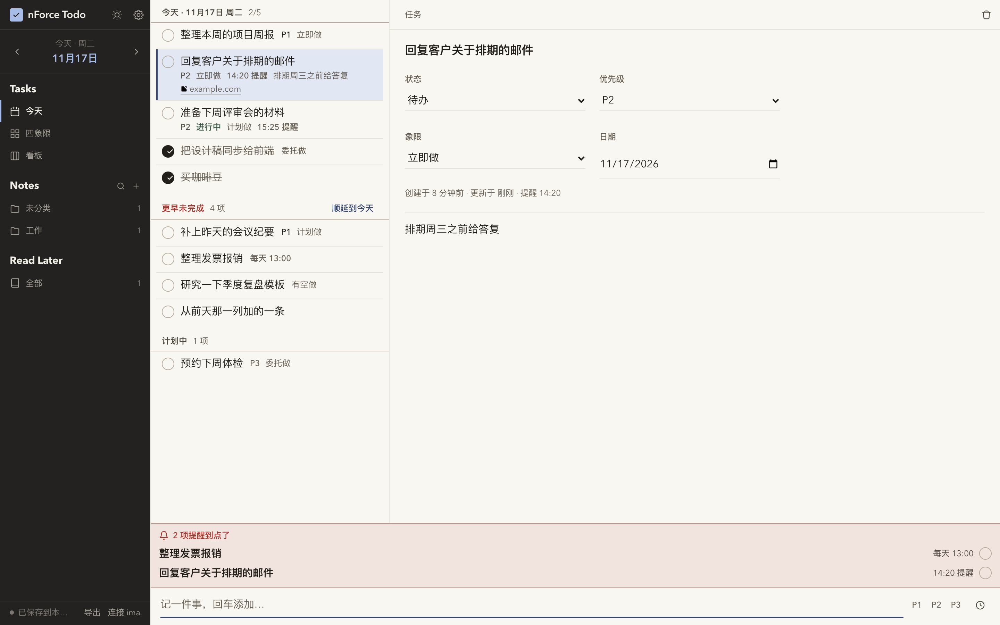
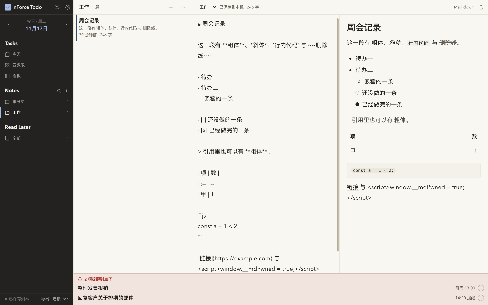

这一版：弹窗的顶部从「两条横带 + 一行日期 + 一行商标」收成一条 39px 的栏。

*点工具栏图标就是它：一条顶栏、输入行、今天的清单，底部一行状态。*

- 之前：顶栏 39（方块 + 产品名 + 日期 + 两个图标）+ 工具行 27（存这个页面 · 荧光笔 · 笔记 · 稍后读 N）——**在能打字之前先过两道顶**，66px 的 560 里。
- 现在：一条 39px 的栏从左到右是 `▣ 存这个页面 荧光笔 ⋯ 笔记 稍后读 N ⤢ ⚙`，输入行紧跟其下。列表多出 27px（一行任务）。
- 为了让四个标签真的挤进这一行（量出来 203px 的内容要塞进 189px 的位置，`存这个页面` 于是折成两行、栏变成 50px），**文字商标（91px）拿掉了**：弹窗本来就是点扩展图标打开的，左边那个带勾的方块就是它自己，名字在工作台的导航里。
- **日期也拿掉了**：三行下面的分组沿口写着「今天 · 11月17日 周二 2/5」，标题栏再写一遍只是同一个标签小一号。

## 另外两个面

*三列：导航 / 列表 / 详情。提醒条和输入行在最下面那一条横带上。*

*左边写 Markdown，右边同时是它读起来的样子。*

下载：<https://github.com/iamnicwu/nForce-Todo/releases/tag/v2.8.0>（源码包与可加载的 zip）。
