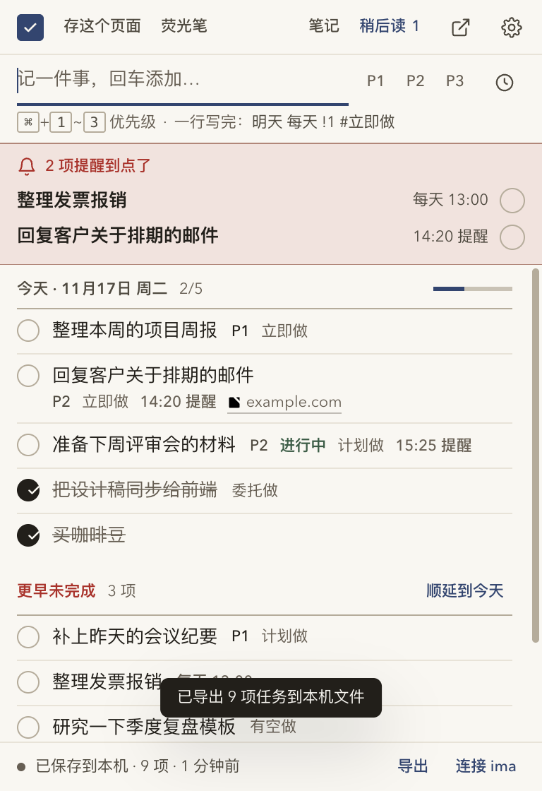
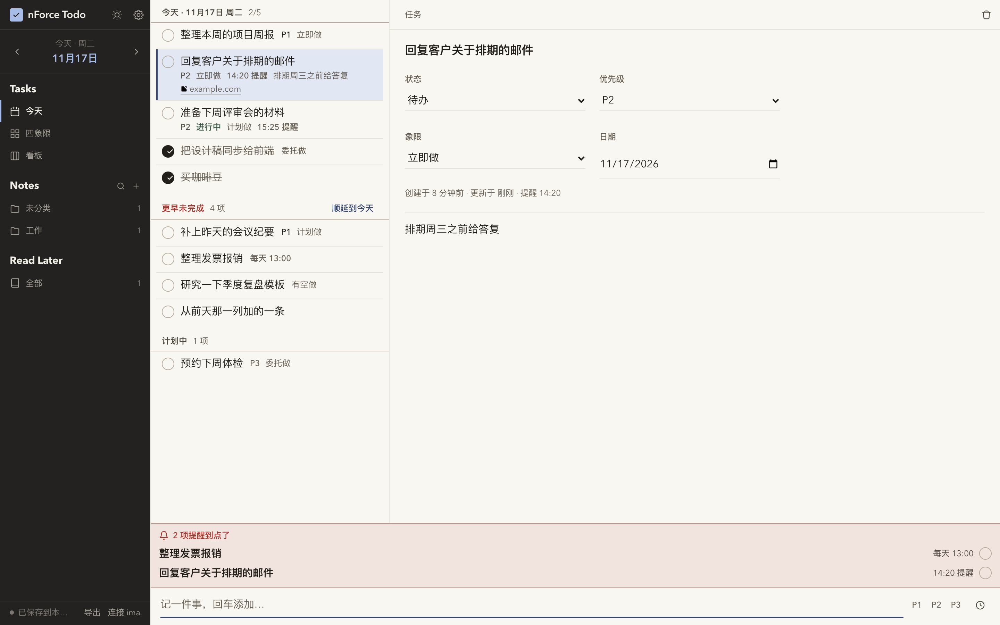
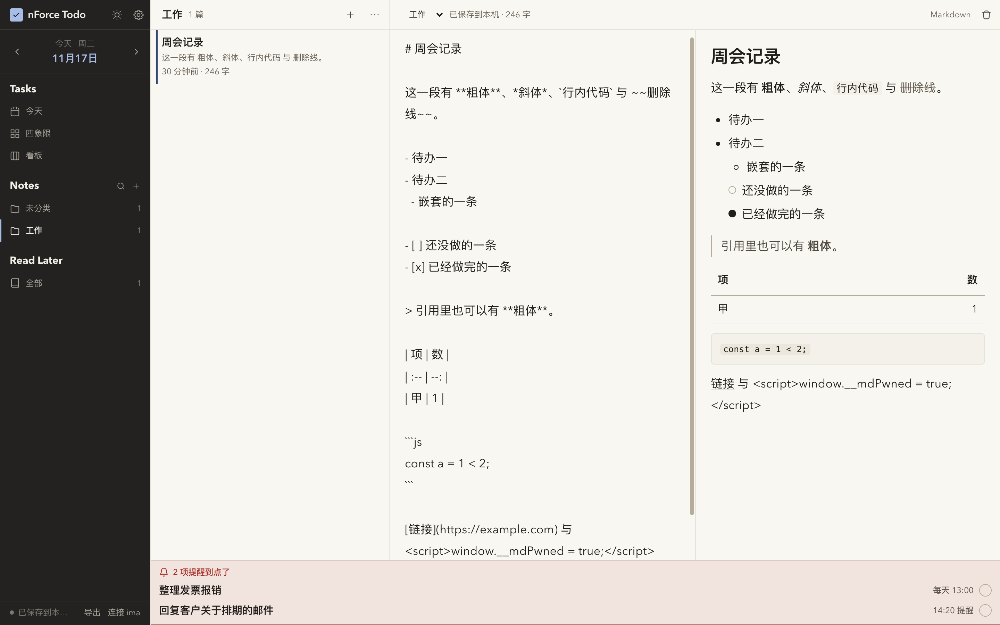

这一版：发版之后，这一版自动变成 blog 上的一篇文章。

*点工具栏图标就是它：一条顶栏、输入行、今天的清单，底部一行状态。*

- `npm run ship` 的第六步：`tools/blog-post.mjs` 从 README 的 `### <版本>` 一节取正文、从它的「一句话」取标题与摘要、从 `screenshots/` 取三张主图，写成 Hugo/PaperMod 的 post 推到 blog 仓库的 `blog-source` 分支。构建与部署由那个仓库自己的 workflow 完成，这边不做第二次部署。
- **失败不影响发布**：tag 和 Release 已经发完，一篇文章没推上去不该把它们作废；命令行会把补发那一行打出来（`node tools/blog-post.mjs --version X.Y.Z`）。`--no-blog` 整步跳过。
- 幂等靠文件名：`content/posts/nforce-todo-v<版本>.md` 已经存在就跳过 —— 手改过的内容不会被下一次运行覆盖。

## 另外两个面

*三列：导航 / 列表 / 详情。提醒条和输入行在最下面那一条横带上。*

*左边写 Markdown，右边同时是它读起来的样子。*

下载：<https://github.com/iamnicwu/nForce-Todo/releases/tag/v2.8.1>（源码包与可加载的 zip）。
