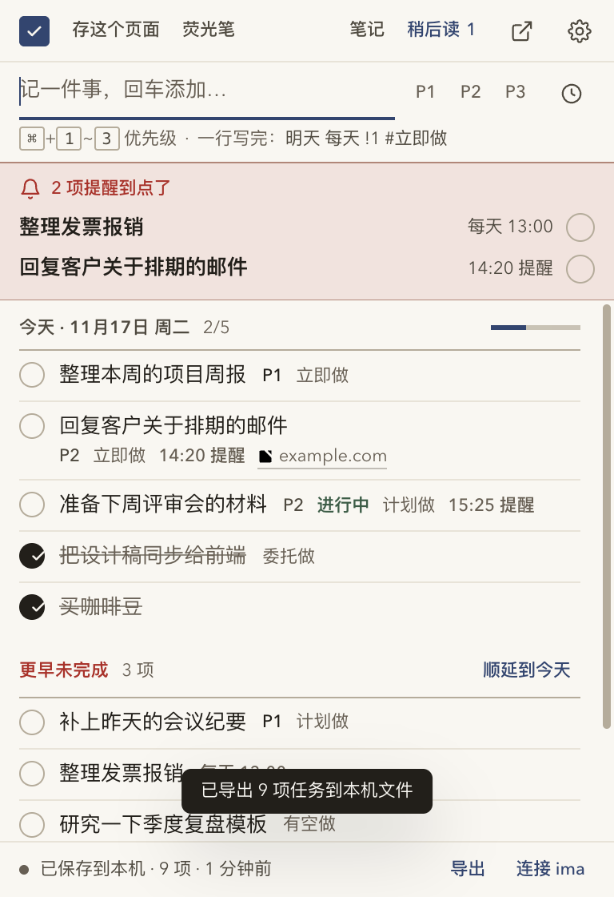
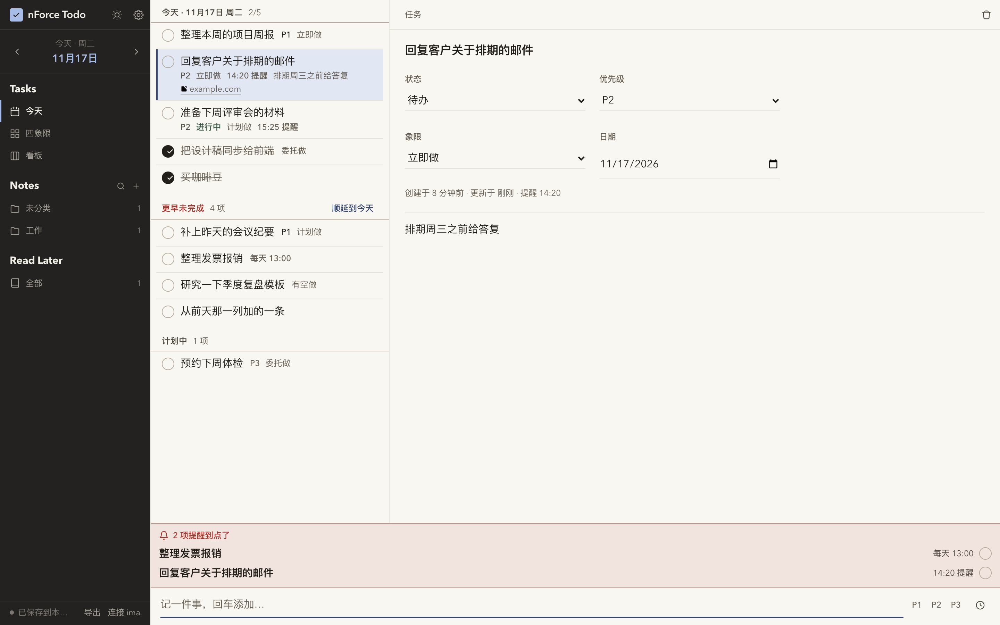
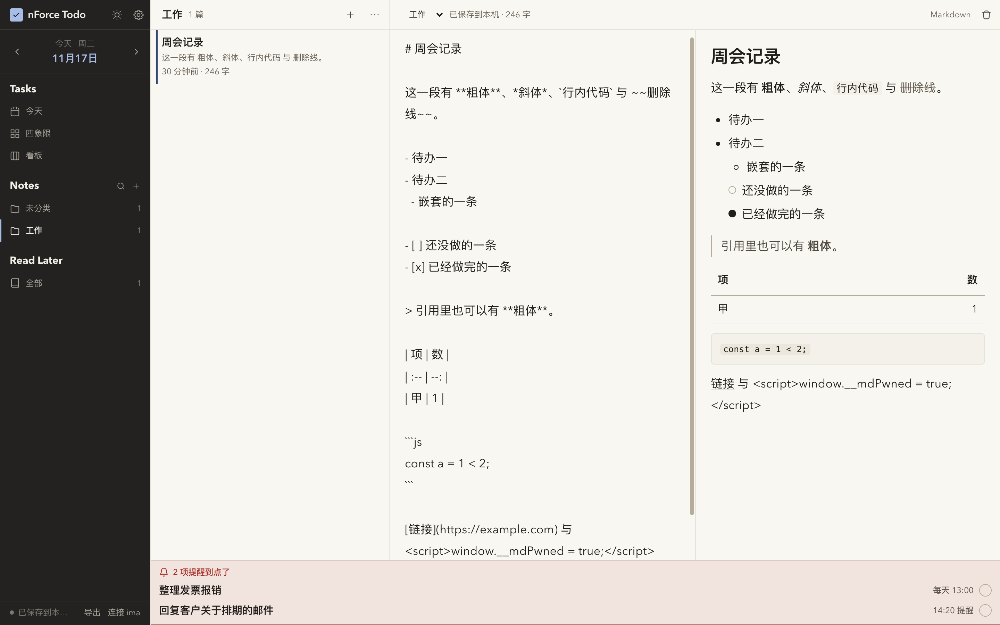

这一版：写 blog 那一步第一次真跑就挂在克隆上，因为三种传输只抄了一半。

*点工具栏图标就是它：一条顶栏、输入行、今天的清单，底部一行状态。*

- 2.8.1 的第六步在真实发版里第一次跑，`git clone` blog 仓库直接报 `Error in the HTTP2 framing layer` —— 正是主仓库 push 早就处理过的那个代理毛病，只是新文件里没抄过来：克隆和推送各自只试了一种传输。
- 现在克隆与推送都走同一张顺序表：默认 → 降到 HTTP/1.1 → 绕开代理。第一次真正需要它的时候，克隆前两种都失败、第三种成功；推送第二钟成功。
- 顺带把这条写进判断：**任何对 GitHub 的 git 调用都要问一句「三种传输试了吗」** —— 漏一个就会在最不该失败的地方（发布已经完成之后）失败一次。

## 另外两个面

*三列：导航 / 列表 / 详情。提醒条和输入行在最下面那一条横带上。*

*左边写 Markdown，右边同时是它读起来的样子。*

下载：<https://github.com/iamnicwu/nForce-Todo/releases/tag/v2.8.2>（源码包与可加载的 zip）。
