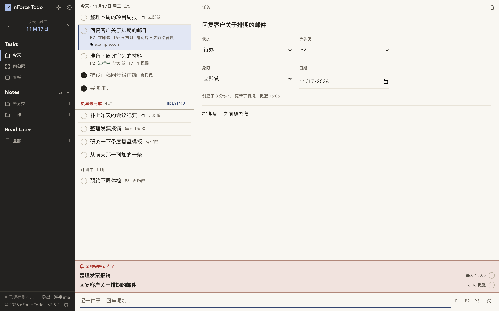
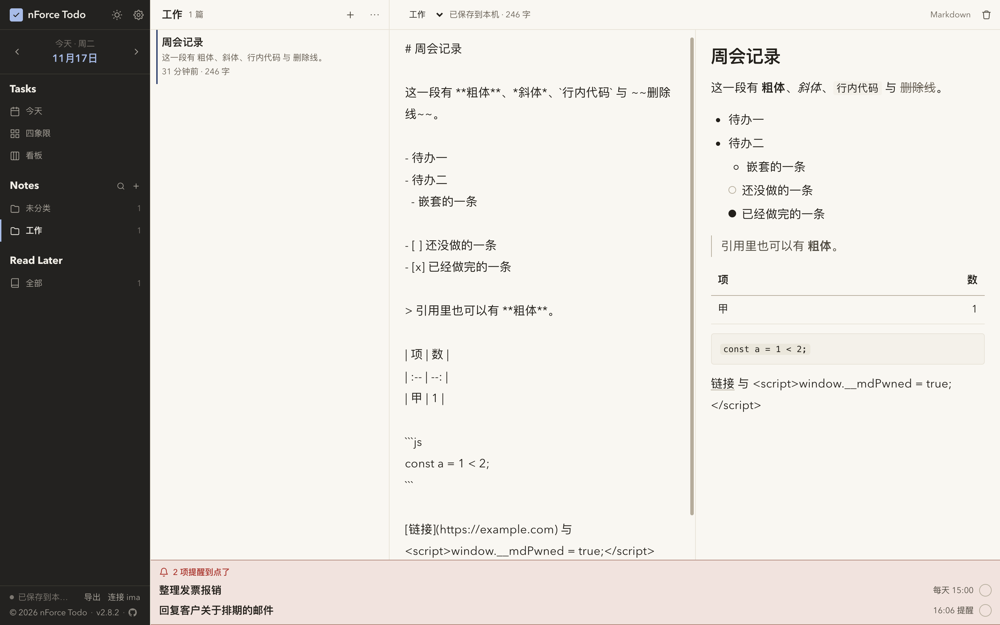

这一版：工作台左下角有了版权行，顺手删掉两条已经没人用的样式。

*点工具栏图标就是它：一条顶栏、输入行、今天的清单，底部一行状态。*

- 版权行按另外几个插件的格式：`© 2026 nForce Todo · v2.9.0 · <一个去处>`。版本号由 `app.js` 从 manifest 读，不写死一份会漂移的；去处指到 blog。放在导航栏底部、状态行下面一行 —— 那里是「笔记页面的左下角」。
- 字号用 `--text-2` 而不是 `--text-3`：12px 在深色导航上，`--text-3` 只有 3.2:1，读不动。
- 删掉 `.chip--accent` 与 `.dot--accent`：2.6.0 起「进行中」有了自己的 tone，`accent` 这个 tone 已经没有数据再用，留着只是一条会误导人的规则。

## 另外两个面

*三列：导航 / 列表 / 详情。提醒条和输入行在最下面那一条横带上。*

*左边写 Markdown，右边同时是它读起来的样子。*

下载：<https://github.com/iamnicwu/nForce-Todo/releases/tag/v2.9.0>（源码包与可加载的 zip）。
