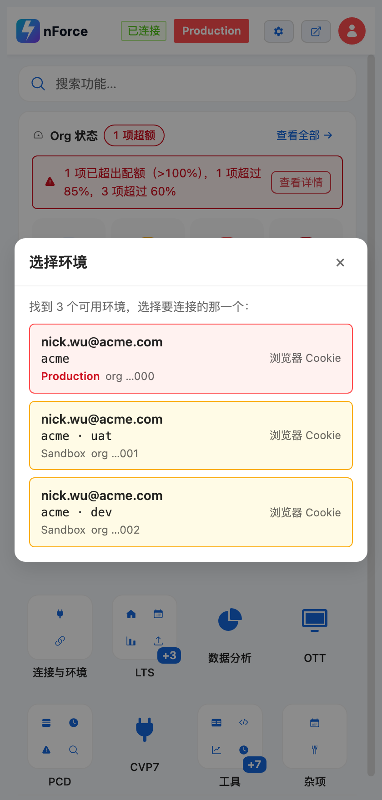

上一篇写这个扩展还是 v4.15。中间一直在改，但没写下来。这次先把最近这一轮（v4.45 到 v4.49.1）记一下，都是自己用的时候卡出来的问题。

## 批量查询：先修一个会白查一轮的 bug

批量 SOQL 查询会在你给的模板上自动加时间条件。问题出在**判断"有没有 WHERE"**这一步：

```js
upper.startsWith("WHERE ", i)   // 只认后面跟一个空格
```

我习惯把查询写成多行：

```sql
SELECT Id, OrderNumber
FROM Order
WHERE Status = 'New'
```

`WHERE` 后面是换行，不是空格。于是它认为"没有 WHERE"，在末尾又拼了一个 `WHERE (CreatedDate >= ...)` —— 两个 WHERE，SOQL 直接报错。tab、`WHERE(...)` 同样漏判。

改成按**关键字边界**判断（前后是空白或括号才算关键字），顺带把 `WHEREABOUTS__c` 这种字段名排除掉。原来那套"把原谓词整段加括号再接 AND"的处理没动，`A OR B` 的语义不会被改。

### 然后是不想再靠猜

修完这个 bug 我意识到另一个问题：**拼出来的 SQL 我根本看不到**。报错了只能猜是哪个条件拼坏了。

现在点击执行后，先把每批**真正要发出去的那条 SQL** 打到 console：

```
[nForce][BATCH] [批查询] 模式=文件数据 · 批数=38 · 匹配字段=OrderNumber
--- [1/38] 第 1 批 · 200 个值 ---
SELECT Id, OrderNumber FROM Order WHERE OrderNumber IN ('...') ORDER BY CreatedDate DESC
… 另有 35 批结构相同，只在 IN 列表的值 / 日期窗口上不同
```

批数多时不刷屏：前 3 批完整打，其余折叠成一句；**会被跳过的批次不论第几批都单独列出**（它不会发出去，藏起来会让人以为少跑了一批）。要全部内容就在 console 里 `copy(__nforceBatchSoql.map(q => q.soql).join(';\n'))`。

顺带一个收益：SQL 在执行前一次性拼好，非法批次**开跑前**就暴露，不用跑到第 20 批才发现同一类错误。

## 搜索键换成 Ctrl+K

以前在任意网页上按 `Alt+Shift+S` 唤出搜索。这个组合键是我当初随手选的，实际很少按 —— 手要跨到 Shift+Alt。

现在默认 `Ctrl+K`（macOS 上是 `⌘K`），并把原来"插件页面内另有一条快捷键"整个删了：全局那条在任何页面都会触发，落到插件自己的页面时后台会转去唤起面板搜索，面板内再单独判一次键是重复的。

有一个代价得说清楚：**`⌘K` 原本是浏览器"聚焦地址栏搜索"**。现在按它出来的是这个扩展的搜索，不再是地址栏。装完如果想改回来，去 `chrome://extensions/shortcuts` 改那一条就行。

## 选择环境：显示"谁"，也显示"哪个环境"

浏览器里同时登着 prod、uat、dev 三个 org 时，会弹出选择框。以前每行是主机名：

```
acme.my.salesforce.com
acme--uat.sandbox.my.salesforce.com
acme--dev.sandbox.my.salesforce.com
```

45 个字符里，只有 4~5 个在区分它们。

中途试过一版"显示用户名"就收工 —— 但没用：**同一个管理员账号在三个 org 上的用户名完全一样**（`nick.wu@acme.com` ×3）。换成用户名之后三行还是一模一样。

所以现在是两行：上面是"谁"，下面是"哪个环境"。



- 标题：用户名 → 显示名 → `未识别用户`（**不再退回把 URL 当标题**，URL 说不清这是谁的会话）
- 副标题：只留"客户域 · 沙箱别名"，`acme` / `acme · uat` / `acme · dev`
- 完整主机名没丢，移到每行的悬停提示里

一个小判断：经典实例的 `acme--c.cs10` 会被压成 `acme` —— `cs10`、`na1` 这类实例名在同一个客户下也会重复，当别名用会误导。

## 到期报表：PCD 过期和另外两份对齐

这三份报表原来有两套写法：PCD 过期写 `Action` 列，T-4 到期和续期写 `Latest Action By` + `Issue Status`。同一个"谁在处理"的问题，两个地方两个答案。

这次把 PCD 过期也换成 `applyExpiryRules`，口径统一，`v4.42` 那条「补库存」规则（卡在等货的单标成 `COM(LTS) - Inventory Replenishment`）也就一起适用于它了。

中间踩了一个坑，值得记一下：我把 T-4 那条查询的字段从 30 个精简到 13 个，顺手删掉了 `Order.LOB__c`、`Order.CreatedBy.Name`、`FulfillmentDetail__c`。这三个不是展示列，是**规则输入**：

- `LOB__c` 决定这一单算 `COM(LTS)` 还是 `COM(PCD)`。删了它就是 undefined → 每一行都算成 PCD，LTS 的单全部错派
- `CreatedBy.Name` 有几条规则以 `createdBy === "integration.user"` 为前提，删了永不命中
- `FulfillmentDetail__c` 是地址被拒、改约这类判定的输入

不会报错，只是结果悄悄变了。现在补回去了，代码里也加了注释。以后精简查询列，这三列要留着。

## 试了一版"标签页按环境上色"，撤了

想法很直接：生产标签页染红、沙箱染蓝，一眼分清两边。

Chrome 的约束比想象中硬：标签页本身不能设任意颜色，唯一机制是**标签组**，而标签组只有 9 种固定颜色。判断依据也得用每个标签页自己的 URL，不能按"当前连的是哪个 org"（那样两边会被染成同一个颜色，功能就白做了）。

做出来了，能跑，也确实能区分。但实际用下来它的收益配不上它带来的干扰 —— 它会动你的标签组，会和已有的分组习惯打架。所以给了个功能总开关先关掉，代码留着，界面那块也隐藏了。已经建好的分组不会被解散，只是不再更新。

## 到这儿

v4.45 → v4.49.1。这几轮基本都在修"用的时候才发现"的问题，而不是加新功能。下一轮想收拾的是业务页里的表格：列多、密度大，窄侧边栏里读起来还是费劲。

扩展还是那个地址：<https://github.com/iamnicwu/nForce-tools>
